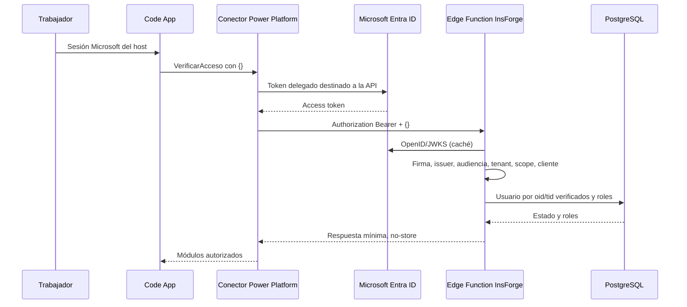

# Autenticación Entra ID y RBAC — estado al 12 de octubre de 2026

> Actualización posterior: la fase funcional solicitada utiliza GUID, no OAuth. Su guía vigente está en [sistema-votaciones-funcional.md](sistema-votaciones-funcional.md). La implementación JWT de este documento se conserva en `/verificar-acceso-entra`; `/verificar-acceso` ahora corresponde a la fase GUID temporal. Los resultados y rutas anteriores de este documento describen la etapa JWT previa, no autentican las operaciones electorales nuevas.

## Actualización: diagnóstico de Origin del gateway

**Causa confirmada y configuración corregida:** la respuesta compartida por el usuario con X-URH-Diagnostic-Id `d2c45fd8-98d5-4c61-bc62-d537bcf8f1a3` coincide con el log recibido por la función: originPresent=true, Origin saneado `https://make.powerautomate.com`, Authorization presente y SkipAuthorization ausente. El gateway sí transmitía un Origin aunque no apareciera en la vista de solicitud del diseñador. Microsoft documenta este comportamiento en [Forwarded client request headers](https://learn.microsoft.com/en-us/connectors/common/known-issues#forwarded-client-request-headers).

Se añadió exclusivamente `https://make.powerautomate.com` a ACCESS_ALLOWED_ORIGINS, conservando los cuatro orígenes anteriores. Es configuración CORS, no una credencial. No se cambiaron claves, JWT, audiencias, tenant, scopes, clientes autorizados, PostgreSQL o código de otras funciones. Se volvió a desplegar únicamente la fuente verificar-acceso para refrescar esa configuración en el runtime de pruebas; el hash de powerbi-workspaces-sync se mantuvo igual.

Después del cambio: POST desde el origen Power Automate sin token → 401 TOKEN_AUSENTE (779 ms); con token inválido → 401 TOKEN_INVALIDO (375 ms); CORS devuelve exactamente ese origen, no `*`. Origen ajeno → 403 sin CORS (343 ms); sin Origin/sin token → 401 (184 ms). **61 pruebas** pasan, incluida la regla exacta del portal con JWT local válido y rechazo de dominios parecidos. Las dos pruebas positivas con JWT firmado válido siguen siendo automatizadas/locales; falta repetir con el token Microsoft real del conector.

El wildcard observado por el usuario en los headers de respuesta del gateway no fue emitido por el handler directo: las pruebas HTTPS directas devolvieron ausencia de CORS para origen rechazado y origen exacto para permitido. No se añadió wildcard como solución. Las capas Power Platform/proxy pueden modificar headers de su respuesta al cliente; no confundir esa cabecera con la política aplicada dentro del handler.

El conector devolvió 403 ORIGEN_NO_PERMITIDO mientras su vista de solicitud mostraba solo Authorization/SkipAuthorization. Se comparó el código desplegado: **ya permitía POST sin Origin**, manteniendo JWT obligatorio. El 403 implicaba que el handler recibió un Origin no vacío fuera de la lista; la vista del diseñador no muestra necesariamente todos los headers añadidos durante el tránsito. Los logs históricos solo registraban método/status, por lo que no permiten conocer el valor exacto del Origin de aquella petición.

Se actualizó y desplegó únicamente la fuente de verificar-acceso en PRONIED de pruebas. Ahora se distingue explícitamente `Origin` ausente de un header vacío o literal `null`: solo el ausente pasa a validación JWT sin CORS; los otros deben estar autorizados o se rechazan. No se modificaron las validaciones JWT, la allowlist ni secretos. Referer y encabezados de gateway no conceden acceso.

Ante un Origin rechazado se devuelve X-URH-Diagnostic-Id. El runtime registra como máximo cinco eventos por minuto/instancia con el ID, origen saneado, originPresent y booleanos authorizationPresent/skipAuthorizationPresent. No registra valores de Authorization/SkipAuthorization, tokens, cookies, Referer, cuerpo, credenciales en URLs o claims. Orígenes inválidos/vacíos/opacos se representan mediante categorías; no se refleja el origen en Access-Control-Allow-Origin ni en el JSON de respuesta.

Pruebas tras despliegue:

| Prueba HTTPS directa | Resultado |
| --- | --- |
| POST sin Origin ni token | 401 TOKEN_AUSENTE, 1136 ms |
| POST sin Origin con token inválido | 401 TOKEN_INVALIDO, 373 ms |
| POST con Origin explícito no autorizado | 403 ORIGEN_NO_PERMITIDO, sin CORS, 367 ms |
| POST Origin permitido sin token | 401 TOKEN_AUSENTE, CORS exacto, 142 ms |
| POST Origin literal null | 403 ORIGEN_NO_PERMITIDO, 267 ms |
| OPTIONS Origin permitido | 204, CORS exacto |

TypeScript, ESLint y **60 pruebas** pasan. Las nuevas pruebas con RSA/JWT locales verifican POST sin Origin con token válido → RBAC/200, Origin permitido con JWT válido → RBAC/200, rechazos y diagnóstico sin secretos. No se dispone todavía de un token Microsoft válido del conector para repetir esos dos casos positivos por HTTPS.

El usuario debe repetir VerificarAcceso con `{}` y compartir solo status/estado/X-URH-Diagnostic-Id. La nueva entrada correlacionada permitirá comprobar el header realmente recibido desde Power Platform. No inferir el origen concreto a partir de los dominios genéricos Microsoft ni añadirlo automáticamente. Si sigue el 403, una llamada real con Origin explícito sigue bloqueada conforme a la política solicitada: revisar el valor recibido y la configuración del conector/gateway. La actualización no elimina headers recibidos ni los considera ausentes por pertenecer al gateway.

Resultados esperados al repetir: 200 AUTORIZADO con JWT y roles válidos; 401 si token ausente/inválido/expirado; 403 para Origin explícito no autorizado, permisos insuficientes, cliente no permitido o usuario sin acceso; 503 para dependencia no disponible. No se cambió PostgreSQL ni se publicaron cambios de Code Apps. La CLI sincroniza el runtime compartido de InsForge; se comprobó que el hash de la fuente de powerbi-workspaces-sync no cambiara.

## Actualización: despliegue autorizado en PRONIED de pruebas

El usuario confirmó que PRONIED es el entorno de pruebas autorizado. **Se desplegó verificar-acceso**, con estado active y deployment success, el 12 de octubre de 2026. Esta actualización sustituye las referencias históricas a «no desplegado» en las secciones anteriores a esta autorización. Code Apps NO se publicó.

Endpoint preferido verificado:

```text
https://feiztkc9.function2.insforge.app/verificar-acceso
```

Se crearon las configuraciones de servidor ENTRA_TENANT_ID, ENTRA_AUDIENCES_V1, ENTRA_AUDIENCE_V2, ENTRA_ALLOWED_CLIENT_IDS y ACCESS_ALLOWED_ORIGINS mediante el secret store oficial. La lista de orígenes configurada es apps.powerapps.com, make.powerapps.com y localhost en puertos 5173/5174. No se revelaron valores privados. El handler reutiliza el secreto protegido API_KEY ya disponible en InsForge cuando RBAC_SERVER_API_KEY no está definido; no se duplicó ni imprimió esa credencial. INSFORGE_BASE_URL ya existía. Es un secreto administrativo server-side, no una autorización del elector; toda petición sigue requiriendo un JWT Microsoft validado.

El código de powerbi-workspaces-sync no cambió y su updatedAt se conservó. InsForge comparte un runtime/despliegue entre las funciones del proyecto; no se invocó esa función ni se realizaron sus operaciones de sincronización.

Pruebas **HTTPS contra el runtime alojado real**:

| Caso | Resultado | Tiempo observado |
| --- | --- | --- |
| POST {} sin token | 401 TOKEN_AUSENTE | 674 ms |
| POST con Bearer inválido | 401 TOKEN_INVALIDO | 369 ms |
| GET | 405 METODO_NO_PERMITIDO | 198 ms |
| OPTIONS con origen permitido | 204, CORS exacto apps.powerapps.com | 233 ms |
| POST con origen no permitido | 403, sin Access-Control-Allow-Origin | 207 ms |
| JWT sintético RS256 con ver/issuer/aud/scp válidos pero clave ajena a Microsoft | 401 TOKEN_INVALIDO, consulta discovery/JWKS desde runtime real | 1055 ms |

Las respuestas llevan Cache-Control: no-store. El último JWT se generó en memoria con una clave local, nunca se imprimió ni se guardó; no es un token Microsoft legítimo. Su rechazo confirma funcionamiento del camino de verificación en el runtime, **no prueba el caso positivo de token delegado real**. TypeScript, las 53 pruebas y ESLint siguen pasando tras añadir el fallback de secreto server-side.

Pendientes: actualizar/verificar host/path del conector para este endpoint directo, probar VerificarAcceso con {} usando una conexión OAuth real, generar bindings en Code Apps y validar Local Play/publicado. No se concedieron permisos SQL ni se modificaron datos electorales.

En el conector de pruebas: host `feiztkc9.function2.insforge.app`, basePath `/`, POST `/verificar-acceso`, operationId `VerificarAcceso`, body `{}`. Conservar OAuth y su configuración Resource/scope; no introducir una API key de InsForge. Compartir solo HTTP/estado/roles al comprobar el resultado, nunca el token o client secret. El proxy del dominio principal sigue siendo compatible para servidor-servidor, pero mantiene la limitación CORS wildcard descrita abajo.

## Resultado y límites

Código seguro implementado y verificado con criptografía real y tokens **generados localmente para pruebas**. La consulta a PostgreSQL real también fue verificada, separadamente. **El flujo Microsoft → conector → InsForge → Code Apps no está validado de extremo a extremo ni listo para una jornada electoral.** No se emitió/capturó un token Microsoft real, no se desplegó la función y no se publicó Code Apps.

Bloqueos externos comprobados:

1. El conector existe en el entorno de la app, pero la CLI no ve ninguna conexión asociada en estado Connected bajo la cuenta activa. La conexión mencionada por el usuario puede estar en otro contexto/entorno o no ser visible para esta sesión. No se concluye que nunca existiera.
2. `pa connection create --non-interactive` falló: el conector no devuelve `firstPartyLoginUri` y esta configuración no admite ese flujo silencioso. Se requiere conexión OAuth interactiva o revisión de SSO por el administrador.
3. El proyecto InsForge enlazado es PRONIED y ya tiene otra función activa. No hay confirmación de que sea el entorno de pruebas autorizado; no se desplegó sobre él.
4. El proxy `/functions/...` observado añade `Access-Control-Allow-Origin: *`. La validación estricta dentro del handler no puede eliminar esa cabecera añadida posteriormente. Usar el endpoint directo del runtime para una prueba con CORS restringido, o resolver el proxy con el proveedor; no desactivar autenticación ni protecciones globales.
5. La verificación visual adicional en Edge fue rechazada por la política de ejecución. No se reporta como prueba superada.

## Arquitectura implementada



El frontend no lee ni transmite tokens manualmente, no acepta una selección de identidad/roles y no usa getContext como autorización. getContext permanece solo en el diagnóstico temporal del catálogo público existente. La clave pública de catálogos sigue sirviendo exclusivamente para esa lectura, nunca para la autorización.

La seguridad de futuras operaciones debe utilizar los guards del servidor en cada request, no basarse en la respuesta anterior o en botones ocultos. Las pantallas administrativas/electorales son las bases existentes, sin operaciones de escritura ni votos.

## Archivos y reutilización

- `functions/shared/rbac.ts`: lógica RBAC y repositorio REST extraídos del demo, usados por ambos handlers. No se duplicó la consulta.
- `functions/shared/entra.ts`: verificación con `jose@6.2.12`, discovery/JWKS y errores seguros.
- `functions/shared/authorization.ts`: consulta fresca de roles por operación, guard de request y guard electoral que exige una comprobación de padrón de servidor.
- `functions/entra-verificar-acceso.ts`: entry point de producción; POST `{}`. No importa el handler demo.
- `functions/verificar-acceso.ts`: entry point seguro; la demo anterior se conserva en `functions/demo/verificar-acceso.ts`, fuera del artefacto.
- `src/services/powerAppsAccessService.ts`: consumo del SDK público `getClient(...).executeAsync(...)` usando metadata generada por CLI; no inventa una conexión ni crea schemas manualmente.
- `src/types/secureAccess.ts`, `src/hooks/useAuthorizedAccess.ts`, `src/components/AuthorizedApp.tsx`: contrato, estado y manejo de errores.
- `src/components/AccessModules.tsx`: navegación reutilizada tanto por el demo como por acceso real.
- `scripts/build-access-function.mjs`: bundle autocontenido para Deno, con import externo `npm:jose@6.2.12`.
- `scripts/connect-powerapps-access.mjs`: detecta una conexión Connected y ejecuta el comando oficial para generar bindings; si falta o hay varias sin selección, no modifica la configuración.
- `scripts/auth-server.mjs`: adaptador local seguro, solo loopback 8788, token obligatorio.
- `.env.auth.example` y `.env.auth.local`: configuración privada/pública del servidor, sin secreto escrito por el agente.
- `migrations/001_identidad_usuario_unique.sql`: propuesta opcional de índice único de identidad, **no ejecutada**.
- `tests/entra-access.test.mjs`, `tests/secure-http.test.mjs`, `tests/secure-access-client.test.mjs`, `tests/powerapps-adapter.test.mjs`: nuevas pruebas, incluido contrato SDK con bindings simulados.

También se modificaron App, RbacDemo, package.json/lock, .env.example y .gitignore. `.env.local` conserva las variables del catálogo y desactiva RBAC_DEMO. `power.config.json` no cambió: el registro de bindings no pudo completarse. Dependencias añadidas exclusivamente de desarrollo/servidor: jose y esbuild, con versiones exactas. jose no se incorpora al frontend.

## Configuración Microsoft inspeccionada/proporcionada

| Parámetro | Valor |
| --- | --- |
| Tenant esperado | 7542cdab-2ecf-4371-956f-41795bcb56f7 |
| API/cliente actual | f1eb7fb0-a90c-4efb-9a50-f1ddb2c719da |
| Application ID URI | api://f1eb7fb0-a90c-4efb-9a50-f1ddb2c719da |
| Scope | api://f1eb7fb0-a90c-4efb-9a50-f1ddb2c719da/access_as_user |
| Connector ID encontrado | shared_urh-2dvotaciones-2dapi-5f9ce53a357a6829e8-5fc7aadcb41a91d842 |
| Operación esperada | VerificarAcceso |
| Entorno de Code Apps | 5b61b3f5-0e90-e928-bcae-e69127947f06 |

La cuenta activa de CLI coincide con el objectId/tenantId de prueba suministrado anteriormente. La CLI reconoce el conector como no tabular, pero no lista una conexión propia asociada.

Redirect URI proporcionada:

```text
https://global.consent.azure-apim.net/redirect/urh-2dvotaciones-2dapi-5f9ce53a357a6829e8-5fc7aadcb41a91d842
```

### AADSTS90009

Según la configuración informada por el usuario, cliente OAuth y API comparten registro; Resource URL se estableció como el GUID `f1eb7fb0-a90c-4efb-9a50-f1ddb2c719da` para superar AADSTS90009. Se conserva como configuración existente, no como solución universal verificada por el agente. No sustituir automáticamente por el URI ni ampliar audiencias para hacer aceptar cualquier token.

La audiencia final depende de la versión del access token que emita la API, no solo del endpoint OAuth usado. Para v2 se exige el GUID de API; para v1 se configuraron explícitamente GUID y Application ID URI. Esto no acepta Graph. Si el token real demuestra otra configuración, revisar registro/Resource/scope/issuer con el administrador; no relajar la validación. Separar cliente y API en registros distintos es una mejora posible, no requisito introducido automáticamente.

## Validación JWT

Biblioteca mantenida [jose](https://github.com/panva/jose), compatible con Node/WebCrypto y Deno. No hay secretos de firma Microsoft: se utilizan claves públicas.

- Solo RS256; header kid obligatorio, tipo JWT/at+jwt, tamaño de token acotado.
- `ver` sin verificar elige únicamente entre dos rutas metadata fijas del tenant configurado. No controla hosts ni URLs.
- Discovery debe devolver exactamente el issuer esperado; jwks_uri está limitado a HTTPS login.microsoftonline.com y las rutas Microsoft previstas, sin redirects.
- Firma/issuer/audiencia y claims obligatorios exp/nbf/iat/oid/tid/ver mediante jwtVerify; tolerancia de reloj 30 segundos.
- tid igual al tenant, oid/tid con formato GUID; scope delegado `access_as_user`; tokens app-only e ID tokens sin scp rechazados.
- Cliente permitido en azp (v2) o appid (v1), lista explícita; no se autorizan clientes Microsoft globales por defecto.
- Cache metadata/JWKS de 10 minutos, timeout de 5 segundos y cooldown de refresh JWKS de 30 segundos. Solicitudes concurrentes comparten descarga; kid nuevo refresca tras cooldown. Un cambio legítimo puede requerir reintento durante ese intervalo; no se acepta una clave desconocida.
- No se registran tokens, identidades, nombres, correos, claves o errores SQL en logs de la implementación.

Se consultaron **realmente** los documentos OpenID del tenant:

| Versión | issuer | JWKS |
| --- | --- | --- |
| v1 | https://sts.windows.net/7542cdab-2ecf-4371-956f-41795bcb56f7/ | https://login.microsoftonline.com/common/discovery/keys |
| v2 | https://login.microsoftonline.com/7542cdab-2ecf-4371-956f-41795bcb56f7/v2.0 | https://login.microsoftonline.com/7542cdab-2ecf-4371-956f-41795bcb56f7/discovery/v2.0/keys |

Ambas consultas devolvieron HTTP 200. Eso valida discovery disponible, **no** emisión de un access token para nuestra API.

[Referencia Microsoft de tokens](https://learn.microsoft.com/en-us/entra/identity-platform/access-tokens), [validación de claims](https://learn.microsoft.com/en-us/entra/identity-platform/claims-validation) y [JWKS remoto de jose](https://github.com/panva/jose/blob/main/docs/jwks/remote/functions/createRemoteJWKSet.md).

## PostgreSQL real

La inspección actual confirmó las mismas columnas documentadas en rbac-demo.md, y los códigos ADMINISTRADOR y ELECTOR. usuario.activo es NOT NULL. **rol y usuario_rol no tienen activo**: las asignaciones presentes a códigos reconocidos se consideran habilitadas; para deshabilitar una asignación debe revisarse el modelo/gestión del DBA. No se inventó una columna ni se cambió el esquema.

project_admin ahora tiene USAGE/SELECT, sin INSERT/UPDATE/DELETE en las tres tablas. anon/authenticated carecen de SELECT de tabla/columna. No se aplicaron nuevos GRANT/RLS. La lectura del usuario de prueba real produjo AUTORIZADO y ambos roles en 1456 ms, sin imprimir nombre o credencial.

El repositorio usa la API REST nativa de InsForge desde servidor con Bearer administrativo y Accept-Profile del esquema. Todas las consultas son GET con columnas y nombres de tabla fijos; filtros via URLSearchParams, UUID verificados y user/role IDs obtenidos de la base. No se concatena SQL aportado por el cliente; la compilación/parametrización SQL la realiza PostgREST. No hay creación automática de usuarios ni ADMINISTRADOR por defecto. Duplicados de identidad fallan cerrado. Las lecturas secuenciales no representan una snapshot transaccional; operaciones futuras de voto requieren una transacción independiente.

La clave administrativa sigue teniendo alcance de proyecto aunque estas tablas estén limitadas a lectura. No exponerla, no usarla para operaciones genéricas elegidas desde JSON y revisar un principal de menor privilegio con InsForge antes de producción. El índice único opcional facilita identidad inequívoca; primero comprobar duplicados. Su aplicación requiere revisión y permisos del propietario, y no se ejecutó.

## Contrato

```http
POST /functions/verificar-acceso
Authorization: Bearer <access-token-Microsoft-destinado-a-la-API>
Content-Type: application/json

{}
```

El endpoint directo del runtime usa `/verificar-acceso`. El handler acepta ambas rutas conocidas, ninguna otra. GET devuelve 405. JSON con oid/tid/id_object/id_tenant/roles/comandos extra devuelve 400, incluso con token válido; no afecta a la identidad. Body máximo 1 KiB.

200:

```json
{"autorizado":true,"estado":"AUTORIZADO","usuario":{"id_usuario":1,"nombre":"Usuario"},"roles":["ADMINISTRADOR","ELECTOR"]}
```

Todos los errores tienen `{autorizado:false, estado:<codigo>, usuario:null, roles:[]}` y `Cache-Control: no-store`. No contienen modo DEMO, datos de otros usuarios ni detalles internos:

| HTTP | Estado(s) |
| --- | --- |
| 400 | SOLICITUD_INVALIDA |
| 401 | TOKEN_AUSENTE, TOKEN_INVALIDO, TOKEN_EXPIRADO |
| 403 | PERMISO_INSUFICIENTE, CLIENTE_NO_AUTORIZADO, SIN_ACCESO, SIN_ROLES, ORIGEN_NO_PERMITIDO |
| 405 | METODO_NO_PERMITIDO |
| 429 | LIMITE_DE_FRECUENCIA |
| 503 | AUTENTICACION_NO_DISPONIBLE, DATOS_NO_DISPONIBLES, CONFIGURACION_NO_DISPONIBLE |
| 500 | ERROR_INTERNO |

Tenant, aud o firma incorrectos se normalizan a TOKEN_INVALIDO. Usuario inexistente e inactivo se normalizan a SIN_ACCESO; SIN_ROLES solo se informa tras autenticar el token. Error SQL nunca se confunde con rechazo de usuario.

La función admite llamadas de conector sin Origin, que son servidor-servidor. Si existe Origin debe estar en lista exacta. OPTIONS solo responde CORS para orígenes permitidos. CORS no es autenticación: el Bearer es obligatorio en toda operación POST. Límite grueso de 600 solicitudes/minuto por instancia, no distribuido: necesita protección de plataforma/gateway y revisión de capacidad antes de producción.

## Variables y entornos

| Variable servidor | Uso |
| --- | --- |
| ENTRA_TENANT_ID | Tenant único autorizado |
| ENTRA_AUDIENCES_V1 | Audiencias v1 explícitas, separadas por comas |
| ENTRA_AUDIENCE_V2 | GUID de API para v2 |
| ENTRA_ALLOWED_CLIENT_IDS | Clientes OAuth permitidos por azp/appid |
| ACCESS_ALLOWED_ORIGINS | Orígenes exactos para navegadores; no wildcard |
| INSFORGE_BASE_URL | API HTTPS del proyecto |
| RBAC_SERVER_API_KEY | Secreto administrativo solo servidor |

`.env.auth.local` fue creado con configuración no secreta. `npm run dev:auth` carga primero `.env.rbac.local` para reutilizar la key privada existente y después `.env.auth.local`. No se duplicó la key. Si se copia `.env.auth.example` con una key vacía, esa variable puede reemplazar la anterior: configurar conscientemente un único valor privado válido. Variables ya definidas en la terminal tienen prioridad; reiniciar servidores al cambiar config.

Desarrollo seguro: servidor loopback 8788, token real obligatorio; no adquiere token por sí mismo. Demo solo opt-in local mediante su comando previo. Pruebas: proyecto/función HTTPS autorizados, datos de prueba, credenciales server-side, sin votos. Producción: mismo handler seguro, nunca loopback ni demo, conector/bindings reales y controles externos validados.

Frontend solo conserva VITE_INSFORGE_URL/VITE_INSFORGE_ANON_KEY para el catálogo público y flags de demo que se eliminan en producción. No hay VITE_ACCESS_TOKEN ni VITE_RBAC_SERVER_API_KEY. `.env*.local`, `.insforge` y `artifacts` están ignorados. El artefacto y bundle no contienen la key administrativa existente.

## Code Apps y conector: pasos reproducibles pendientes

El SDK público instalado declara getClient(dataSourcesInfo).executeAsync({connectorOperation:{tableName,operationName,parameters}}). Esa es la ruta utilizada, con metadata generada, no una API interna del host. El adaptador comprueba conector, operación POST y parámetros de body; invoca `{}`. No tiene fallback fetch anónimo, getContext, token estático ni endpoint localhost en producción.

Sin bindings muestra configuración pendiente y no renderiza módulos protegidos. Los módulos se basan solo en una respuesta AUTORIZADO bien formada; una respuesta RBAC_DEMO o roles desconocidos es rechazada. El catálogo público puede consultarse desde un botón independiente. Reintento descarta roles anteriores; no hay localStorage. El SDK no soporta cancelación de la operación de conector: se descartan respuestas tardías tras timeout/desmontaje. StrictMode de desarrollo puede iniciar llamadas duplicadas del SDK, no escrituras; producción no ejecuta ese doble montaje.

Ejecutar desde el proyecto:

```powershell
pa auth status --json --non-interactive
pa connector list --search URH --json --non-interactive
pa connection list --search shared_urh-2dvotaciones-2dapi-5f9ce53a357a6829e8-5fc7aadcb41a91d842 --json --non-interactive
```

Para crear la conexión, el comando interactivo correcto es:

```powershell
pa connection create --connector shared_urh-2dvotaciones-2dapi-5f9ce53a357a6829e8-5fc7aadcb41a91d842 --display-name "URH Votaciones - Code Apps"
```

Requiere completar OAuth con la cuenta del trabajador/administrador de pruebas. No usar cuenta compartida para identificar nominalmente a todos. Si la conexión existente está en otro entorno, asociarla/crear la correcta; no cambiar el environmentId de la app sin revisar el contexto.

Después:

```powershell
npm run connect:access
```

Si hay varias conexiones propias, seleccionar explícitamente una:

```powershell
$env:URH_CONNECTION_ID='ID-REAL-DE-LA-CONEXION'
npm run connect:access
```

El script usa `pa app add data-source --connector <id-real> --connection-id <id-real> --json --non-interactive`; genera schemas/services y actualiza power.config.json mediante CLI. No se inventaron IDs de conexión. Buscar `generated/appschemas/dataSourcesInfo.ts` o `src/generated/appschemas/dataSourcesInfo.ts`; el adaptador admite ambas ubicaciones. Confirmar en los bindings que VerificarAcceso usa body `{}` y que los errores 401/403 conservan la respuesta/status para las pantallas apropiadas. Esos detalles no pudieron validarse con la conexión real todavía.

Luego compilar y abrir Local Play con `pa app run`. Comprobar que el token pertenece al mismo usuario institucional esperado y que la conexión no usa otra cuenta. No copiar el token completo a logs/capturas.

[Guía oficial Code Apps](https://learn.microsoft.com/en-us/power-apps/developer/code-apps/how-to/connect-to-data) y [OAuth de conectores Entra](https://learn.microsoft.com/en-us/connectors/custom-connectors/azure-active-directory-authentication). Consentimiento/sesión inicial y MFA pueden requerir interacción; no se afirmó SSO transparente. Revisar DLP, licencias de Code Apps/conector y consentimiento institucional para el scope. La preautorización/on-behalf-of requiere administración del tenant, no solo conectar la cuenta.

## Runtime InsForge y despliegue

CLI actual: `npx -y @insforge/cli functions deploy <slug> --file <path>`. Funciones Deno con export default de Request → Response; npm:jose usa WebCrypto compatible. Node/TypeScript y bundling fueron ejecutados, pero no la función en un runtime Deno alojado.

Runtime descubierto: `https://feiztkc9.function2.insforge.app`. Solo se listó la función powerbi-workspaces-sync activa; verificar-acceso no estaba desplegada.

Dos POST a rutas de verificar-acceso inexistente con Bearer deliberadamente inválido (no secreto) devolvieron 404, no 401:

- `https://feiztkc9.us-east.insforge.app/functions/verificar-acceso`: CORS `*`.
- `https://feiztkc9.function2.insforge.app/verificar-acceso`: sin cabecera CORS global.

Esto y el [proxy oficial](https://github.com/InsForge/InsForge/blob/main/backend/src/server.ts) indican que esta ruta de invocación no exige token InsForge antes de enrutar y conserva Authorization; **no prueba que un token Microsoft válido haya llegado a una función desplegada**. El código oficial de main no demuestra por sí solo la versión exacta alojada. La prueba final debe llamar al handler ya desplegado con token real.

Para CORS estricto se recomienda configurar el conector de PRUEBAS con host `feiztkc9.function2.insforge.app`, basePath `/` y operación POST `/verificar-acceso`, conservando operationId VerificarAcceso. Si se mantiene la ruta prevista del proxy `/functions/verificar-acceso`, su wildcard es una limitación pendiente que impide afirmar cumplimiento de CORS restringido. No es una razón para aceptar tokens inválidos o introducir una key administrativa en Power Apps.

### Comandos preparados, NO ejecutados

Primero identificar y autorizar el proyecto de pruebas, configurar los secretos del servidor mediante el dashboard protegido, confirmar que desplegar no afecte otras funciones del proyecto y actualizar el host/path del conector de pruebas:

```powershell
npm run build:function
npx -y @insforge/cli functions deploy verificar-acceso --file artifacts/verificar-acceso.js --name "URH Verificar Acceso"
npx -y @insforge/cli functions list --json
```

No despliega automáticamente `npm run build:function`. No desplegar `functions/demo/verificar-acceso.ts`: es DEMO. El archivo correcto es el artefacto que agrupa el entry point seguro y **entra-verificar-acceso.ts**. Las variables/secretos de funciones deben configurarse antes; RBAC_SERVER_API_KEY nunca va embebida en `--file`.

Para probar solo el servidor seguro local:

```powershell
npm run dev:auth
```

Escucha 127.0.0.1:8788; Power Platform cloud no puede acceder a localhost del desarrollador. El conector necesita una función HTTPS real de pruebas. Los tests locales no cambian esa restricción.

No se ejecutó pa app push; el despliegue a producción requiere cerrar los bloqueos, pruebas con trabajadores de distintos roles, validación explícita de seguridad y aprobación.

## Pruebas ejecutadas

`npm run check:rbac`, `npm run lint`, `npm test`, `npm run build` y `npm run build:function`: correctos. **53 pruebas** incluidas las 17 previas. Claves RSA y JWT de pruebas se generan en memoria, no se guardan tokens reales en fixtures.

Cobertura: Entra v1/v2; GUID/URI v1; roles administrador/elector/ambos; usuario ausente/inactivo/sin roles; ausencia, expiración, firma incorrecta, algoritmo no permitido, tenant/issuer/audiencia Graph inválidos; ID token/app-only; scope insuficiente y cliente no permitido; spoofing de oid/roles en JSON rechazado; DB/JWKS/discovery caídos; CORS/GET; 20 solicitudes concurrentes; caché; rotación de kid tras cooldown; límites; roles reevaluados y padrón/rol electoral. Integración HTTP real local: JWT generado localmente + mock Microsoft JWKS/repositorio, respuesta 200 y rechazos 400/401; no representa Microsoft real.

Servidor seguro con configuración real: POST sin Bearer → 401, GET → 405. Lectura REST a PostgreSQL real → AUTORIZADO, ambos roles, 1456 ms. Discovery Microsoft real v1/v2 → 200. Ninguna de estas pruebas separadas completa el flujo delegado.

Audit de dependencias reportó cero vulnerabilidades después de fijar jose 6.2.12 y esbuild 0.28.2; audit de dependencias de producción también cero. Hubo bloqueos temporales de limpieza de binarios esbuild por servidores activos; instalación y compilación finales completaron. No se ejecutó npm audit fix --force ni se alteró Vite config.

La inspección del bundle/artefacto comprobó ausencia de la key administrativa existente, patrones de key administrativa, cuerpo demo id_object/id_tenant y endpoint loopback de demo. Artefacto incluye import npm:jose con versión exacta, no handler/fixtures RBAC_DEMO. El catálogo sigue incorporando su clave anon pública, prevista para lectura pública. La prueba visual adicional de Edge fue bloqueada por política, pendiente de ejecución manual en Local Play y app publicada.

## Requisitos pendientes y criterios de aceptación

| Criterio | Estado comprobado |
| --- | --- |
| Microsoft emite token para API propia | Pendiente de conexión real y prueba OAuth |
| InsForge valida token Microsoft real | Código/test criptográfico local OK; runtime HTTPS y token real pendientes |
| Backend deriva oid/tid del JWT verificado | Implementado y probado con firmas locales |
| PostgreSQL devuelve roles reales | Verificado separadamente para la cuenta de prueba |
| Code Apps consume conector autenticado | Bloqueado: no conexión visible/bindings |
| UI muestra módulos autorizados | Guards/componentes reutilizados y contrato probado; integración visual con conector pendiente |
| Backend rechaza no autorizados | Verificado con tests y servidor local sin token |
| Build sin suplantación/secreto administrativo | Verificado |
| Pruebas pasan | 53, TypeScript/ESLint/build correctos |
| Documentación reproducible | Este documento y scripts |

Listo para pruebas controladas tras configurar conexión HTTPS y secretos. **No aprobado para producción electoral**: no existe token/deployment/Code Apps E2E verificado, y falta límite distribuido/capacidad, revisión de credencial de servidor, roles activos del modelo y CORS del camino escogido.

## Votos futuros

No se implementó emisión de votos. Antes de hacerlo: transacción única para autorización vigente, padrón habilitado, evento abierto y opción del evento/segmento correcto; unicidad de participación por padrón/usuario y elección según reglas; idempotencia/reintentos; bloqueo adecuado o aislamiento para concurrencia; auditoría mínima; no almacenar tokens en registros electorales. Las tablas inspeccionadas tienen solo PK en participación/voto/padrón_detalle, sin restricciones adicionales de unicidad electoral o FK declaradas; no se crearon.

El sistema solicitado ahora es nominal: establecer expresamente quién puede consultar el vínculo votante-opción y cuánto tiempo se conserva. Si posteriormente se exige secreto, el vínculo actual voto.id_participacion requiere rediseño; no prometer anonimato del modelo existente.
