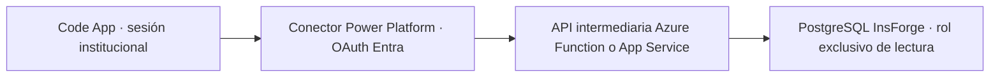

# Prueba de integración — 11 de octubre de 2026

**Actualización:** el usuario autorizó posteriormente el catálogo público y la lectura HTTP/local ya fue verificada con la clave oficial. Ver [resultado-prueba-insforge.md](resultado-prueba-insforge.md). Este documento conserva el diagnóstico y la propuesta anterior de acceso autenticado; esa arquitectura no se implementó.

## Estado

Implementación frontend preparada y compilada; lectura real bloqueada por autenticación y permisos. No se ha probado una consulta exitosa ni la aplicación publicada. No se crearon sesiones, credenciales, funciones, usuarios o permisos. No se ejecutó `pa app push`.

El usuario autorizó únicamente acceso institucional autenticado con Microsoft Entra ID, sin segundo inicio de sesión. Por ello se detuvieron los cambios de seguridad y se eliminó la opción de clave anónima del cliente.

## Diagnóstico verificado

La única lista mock del proyecto está en `src/App.tsx`: selector de segmentos. No existían SDK de InsForge, servicios, hooks, variables de entorno o referencias a conectores. Se conserva el formulario y sus estilos, añadiendo estado de carga, error, vacío y botón de actualización.

Catálogo elegido: `urh_votacion.segmento`.

| Columna | Tipo PostgreSQL | Nullable | Modelo frontend |
| --- | --- | --- | --- |
| id_segmento | integer | No | id |
| dsc_segmento | varchar(500) | Sí | nombre |
| ord_segmento | integer | Sí | orden |

Los nombres se obtuvieron del catálogo `pg_attribute`, sin asumir correspondencia con los mocks. Una descripción nula o vacía se muestra como «Segmento {id}»; orden nulo se muestra «Sin orden» y se coloca al final. No se conocen el número ni los valores de los registros: el rol MCP no puede leerlos.

Tablas detectadas mediante `pg_class`: candidatura, dependencia, evento, opcion_electoral, padron, padron_detalle, participacion_electoral, personal, segmento, voto. No se consultaron datos personales ni votos.

`current_setting('pgrst.db_schemas', true)` incluye `urh_votacion`. Esto confirma la configuración visible desde SQL; aún falta verificar su aceptación en una llamada HTTP autenticada. `segmento` tiene RLS desactivado. Los roles `anon`, `authenticated` y `project_admin` tienen `USAGE=false` sobre el esquema y `SELECT=false` sobre la tabla.

La consulta inicial a `information_schema.columns` devolvió cero filas por visibilidad de permisos; no significaba que faltaran tablas. Las referencias con `::regclass` produjeron `permission denied for schema urh_votacion`. Se usaron joins por OID para inspección sin modificar permisos.

## Método y módulos

API REST nativa, sin instalar librerías:

```http
GET /api/database/records/segmento?select=id_segmento,dsc_segmento,ord_segmento&order=ord_segmento.asc.nullslast,id_segmento.asc&limit=100&offset=0
Accept-Profile: urh_votacion
Authorization: Bearer <token válido para InsForge, nunca token de Entra reenviado sin integración>
```

El SDK actual soporta `database.schema('urh_votacion').from('segmento')`; usa el mismo encabezado. Se revisaron las referencias oficiales REST, database SDK y auth API vía MCP, y el [repositorio del SDK](https://github.com/InsForge/InsForge-sdk-js#selecting-a-schema). Para este GET basta `fetch` nativo.

- `src/services/insforgeClient.ts`: HTTPS, esquema explícito, transporte y errores HTTP. Sin acceso anónimo configurado. `configurarTokenInsforge` es un punto futuro de integración; nadie lo invoca actualmente. No obtiene, renueva ni convierte tokens de Entra.
- `src/services/catalogosService.ts`: lectura paginada, orden en servidor, validación de respuesta y transformación tipada.
- `src/types/catalogos.ts`: columnas reales y modelo visual.
- `src/hooks/useSegmentos.ts`: carga, cancelación, timeout de 15 segundos, error, actualización y medición de latencia total.
- `src/App.tsx` y `src/App.css`: sustitución del mock y estados. Una actualización limpia selección y resultado para impedir información obsoleta.
- `.env.example`: URL pública del backend; no contiene claves. No se cambiaron Power Apps, Vite, dependencias o autenticación.

## Resultados de conectividad

Validación final: `npm run build` y `npm run lint` completados sin errores. Pruebas de servicio con fetch simulado verificaron encabezado de perfil, columnas y orden, paginación de 101 registros en dos páginas, valores null, lista vacía, formato inválido, HTTP 401/403 y fallo de red. Estas pruebas no demuestran lectura real ni ejecución en el host publicado; no se instalaron herramientas de prueba.

| Prueba | Resultado |
| --- | --- |
| GET real, sin token, con Accept-Profile | HTTP 401, AUTH_INVALID_CREDENTIALS, «No token provided» |
| Tiempo GET hasta respuesta de error | 696 ms, una muestra desde este equipo; no es latencia de una consulta SQL exitosa |
| OPTIONS, Origin http://localhost:3000 | Permite ese origen, GET y encabezados authorization,accept-profile |
| Primer intento de red dentro del sandbox | Conexión bloqueada; repetido fuera del sandbox para medir el backend real |
| Consulta de datos reales | Bloqueada por ausencia de token válido y permisos; no se ejecutó con éxito |
| Publicación | Pendiente; no se publicaron cambios |

El hook informa latencia de la lectura completa en éxito; en fallo conserva duración del intento, no se confunde con latencia SQL. El preflight no demuestra que el perfil sea aceptado ni que el origen publicado funcione.

La generación de un token anónimo permanente fue rechazada por revisión automática antes de crearlo; se descartó esa ruta. No debe repetirse, ni usarse una clave administrativa como alternativa.

## Entra ID e InsForge: conclusión

No hay integración Entra configurada: metadata de InsForge muestra proveedores Google/GitHub y ningún proveedor OAuth personalizado. No hay evidencia de un validador de issuer/JWKS de Entra en este backend.

La [integración oficial de autenticación externa](https://insforge.dev/blog/clerk-insforge-auth-integration) requiere tokens HS256 firmados con el secreto de InsForge, audiencia `insforge-api` y rol `authenticated`. Un token habitual de Entra está firmado con claves de Microsoft, tiene su issuer y audiencia de la API destinataria; no cumple ese contrato. No se debe reenviar un token de Graph o del host Power Apps ni compartir secretos para forzar compatibilidad.

InsForge ofrece [Custom OAuth/OIDC](https://insforge.dev/blog/insforge-custom-oauth), pero el flujo termina creando una sesión propia de InsForge y requiere un flujo OAuth adicional. Esto no equivale a aceptar el token del host Power Apps directamente. No se configuró por la restricción de un único flujo institucional. No se hizo una prueba con token Entra real: no hay token destinado a InsForge ni federación configurada. La conclusión se aplica a la configuración inspeccionada, sin afirmar que todo despliegue de PostgREST carezca de soporte para claves externas.

## Arquitectura propuesta sin segundo inicio de sesión



Recomendación: API intermediaria con única operación `GET /catalogos/segmentos`. Valida JWT de Entra mediante JWKS y comprueba firma, expiración, issuer del tenant, audiencia de la API y scope delegado `Catalogos.Read` o asignación autorizada. No confía en nombre/email ni identidad enviada desde el frontend. No recibe SQL, esquema o tabla arbitrarios.

Acceso a datos: conexión PostgreSQL desde el backend con TLS verificado y rol dedicado que tenga únicamente CONNECT al database, USAGE en `urh_votacion` y SELECT de `id_segmento,dsc_segmento,ord_segmento` en `segmento`; sin permisos de escritura, otras tablas, membresías privilegiadas o BYPASSRLS. El DBA debe verificar permisos efectivos heredados de PUBLIC. Credencial solo en Azure Key Vault, obtenida con identidad administrada. Confirmar que InsForge facilita conectividad PostgreSQL para ese backend; no está verificado.

Así se evita usar una credencial administrativa o el secreto de firma global de InsForge incluso en la ruta de datos. Si no hay conexión PostgreSQL habilitada, evaluar con InsForge un principal REST de servicio restringido y de corta duración; no sustituirlo por API key administrativa ni JWT permanente. No se implementa un exchange de tokens sin soporte y revisión del proveedor.

Pasos de configuración, pendientes de ejecutar:

1. Aprovisionar Function/App Service y registrar API single-tenant en Entra; exponer scope delegado `Catalogos.Read`. Configurar autenticación obligatoria y autorización de usuarios/grupos institucionales.
2. Registrar cliente confidencial para el conector; conceder únicamente ese scope y consentimiento institucional. El secreto del cliente pertenece a la configuración protegida del conector, nunca a Vite.
3. Crear conector personalizado en Power Platform con HTTPS de la API, operación GET fija y OAuth 2.0 Microsoft Entra. Registrar la URL de redirect que genere el conector en la app de Entra. Crear una conexión y compartir la app/conector conforme a las políticas del entorno.
4. Usar `pa connection list`, luego `pa app add data-source --connector <identificador-real> --connection-id <id-real>` y consumir el servicio TypeScript generado desde `catalogosService`. Confirmar la sintaxis con `pa app --help` en la versión instalada antes de ejecutar; no inventar identificadores. Esta futura integración sí puede añadir referencias en `power.config.json` mediante CLI.
5. El administrador del backend configura el rol mínimo indicado, la conexión TLS y Key Vault. Ningún GRANT se ha aplicado ahora.
6. Probar localmente con `pa app run`, luego compilar y publicar manualmente. Verificar permiso válido, ausencia de scope, token vencido, consulta vacía, actualización y tiempos. Comparar catálogo con consulta del DBA.

El conector usa la misma identidad Entra; puede requerir consentimiento/conexión inicial y políticas MFA de la organización. No es posible prometer cero interacción adicional, pero no introduce cuenta ni contraseña InsForge. El host no entrega automáticamente un token destinado a la API propia.

Licencias/configuración: habilitar Code Apps en el entorno y autorizar el conector mediante DLP. La [documentación vigente de Code Apps](https://learn.microsoft.com/en-us/power-apps/developer/code-apps/overview) admite Premium, pay-as-you-go, App Pass o auto-claim para usuarios; confirmar la opción del tenant para conectores personalizados. Azure y Key Vault tienen costes propios. [Conexiones y generación de servicios](https://learn.microsoft.com/en-us/power-apps/developer/code-apps/how-to/connect-to-data).

## Restricciones de la aplicación publicada

Para la ruta directa REST, el administrador debe permitir expresamente el dominio del backend en `connect-src` de la CSP del entorno. El [valor predeterminado documentado](https://learn.microsoft.com/en-us/power-apps/developer/code-apps/how-to/content-security-policy) es `none`; el fetch puede quedar bloqueado aunque CORS funcione. No se conoce la CSP efectiva del tenant ni se modificó. Una meta CSP en index.html o un proxy de desarrollo no resuelve la política del host publicado.

Probar OPTIONS y GET con el origen real del iframe publicado, obtenido de DevTools, no deducido de la URL del portal. Comprobar autorización, preflight y CSP separadamente. En la ruta recomendada con conector, las llamadas a la API son mediadas por Power Platform: no se requiere fetch del navegador hacia InsForge, ni exponer sus credenciales. La API sigue obligada a validar Entra.

Configuración actual para inspección local: copiar `.env.example` a `.env.local` si se desea cambiar la URL pública, reiniciar Vite y ejecutar `pa app run`. Se mostrará el bloqueo 401 hasta completar una integración autorizada. Variables VITE se incrustan al compilar y no son almacén de secretos. No está listo para producción ni satisface aún el criterio de mostrar registros reales.
